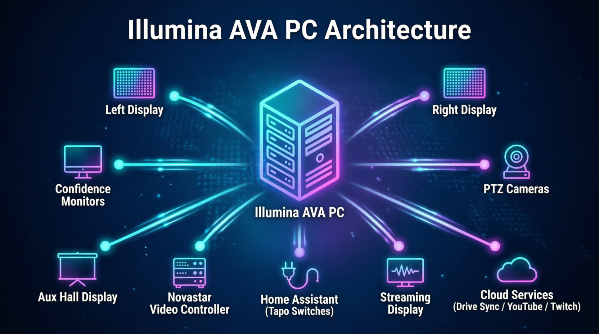

# Illumina AVA PC Deployment Guide

Welcome, and thank you for helping your church bring **Illumina** to life. Illumina is a professional church presentation platform — the operational hub for services, media, streaming, recording, and archives — built with love for True Jesus Church congregations around the world.

This guide turns a standard Windows or Ubuntu PC into a dedicated, self-healing Illumina kiosk in just a few minutes. No IT background needed: the installer asks a handful of friendly questions (ENTER accepts the safe default every time) and handles everything else — certificates, dependencies, displays, and firewall — quietly and correctly.



---

## ✨ What awaits you

* **Displays that follow the operator.** Open the portal and every screen wakes into position; close it and the room sleeps gracefully. A window that crashes relaunches itself within seconds — before anyone even notices.
* **First-run display auto-detect.** The very first launch maps your monitors onto the display roles automatically. Plug in a projector, and Illumina finds its place.
* **Congregation QR that never goes stale.** Members scan once and follow along on their phones. The address is auto-detected live from the AVA PC, so a router change never breaks it.
* **One-tap updates, right in the app.** *Menu → Check for Updates* brings new features, hymns, and Bible text to every AVA PC — the library updates without even a restart.
* **Broadcast-grade streaming.** YouTube and Twitch with a scene-based production deck, PTZ camera control, and an overflow-hall feed — all from the same calm interface.

---

## 🔌 Hardware & Network Planning

Illumina is the central hub of your live production environment, coordinating displays, cameras, and smart infrastructure over the local network. A little planning up front makes setup effortless.

### Display Outputs
* **Left & Right Displays:** The congregation-facing main outputs. LED video walls, laser projectors, and large-format LCD panels are all first-class citizens.
* **CG Overlay:** A dedicated lower-third/chyron output, typically routed into a broadcast switcher or OBS via capture card. Optional — switch it on in **Menu → Settings → Displays** whenever your streaming hardware arrives.
* **Confidence Monitors:** Smaller windowed previews near the operator or pulpit for lyrics, slides, and stream health.
* **Aux Hall Display:** An overflow-room program player with independent audio routing for cry rooms, foyers, or secondary halls (part of a broadcast setup).

### Smart Control & Video Processing
* **Novastar Video Controllers:** Day/evening brightness schedules and LED cabinet health, straight from the portal — no more climbing into the rack.
* **Home Assistant & Tapo Switches:** Bring the LED walls and AV racks up or down from the portal, or as part of a service routine.

### Cameras & PTZ
* **Supported protocols:** VISCA, Pelco-D, and Pelco-P, over UDP (VISCA-over-IP) or serial (RS-232/RS-485).
* **Placement:** keep PTZ cameras on the same local subnet as the AVA PC for low-latency preset recall and live tally.

### Network Requirements
* **Local subnet (port 80, HTTP):** congregation phones (QR overlay + `/view` page), pulpit tablets (`/tablet`), PTZ control, Novastar API, and Home Assistant — no internet required for any of them. The app auto-detects the PC's live LAN address, so the congregation QR works from day one and keeps working even if the router reassigns it.
* **Localhost only (port 443, HTTPS):** the operator portal is served securely on this PC alone.
* **Internet access:** Google Drive slide sync, YouTube/Twitch streaming, and one-tap updates.

---

## 🪟 Option A: Windows 10 / 11 Deployment

### Prerequisites
* A PC running Windows 10 or 11.
* An active internet connection (to fetch the app and its companions).
* Local Administrator privileges for this one-time setup.
* Your GitHub Read-Only Token (provided by your IT administrator).
* *Note: Ensure IIS or other local web servers are not actively binding to port 443.*

### Step 1: Open PowerShell as Administrator
1. Right-click the **Start Button** (Windows icon).
2. Select **Terminal (Admin)** or **Windows PowerShell (Admin)**.
3. Click **Yes** if prompted by User Account Control.

### Step 2: Run the Deployment Script
Copy the command below, right-click inside the PowerShell window to paste it, and press **Enter**:

```powershell
irm https://raw.githubusercontent.com/nickng70/Illumina-Installer/main/install-windows.ps1 -OutFile "$env:TEMP\install-windows.ps1"; Unblock-File "$env:TEMP\install-windows.ps1"; powershell -ExecutionPolicy Bypass -File "$env:TEMP\install-windows.ps1"
```

### Step 3: A Few Friendly Questions
The installer walks you through a short, self-explanatory setup:
* **Access Token:** Paste your GitHub token (kept hidden as you type).
* **Environment Profile:** A dedicated, locked-down kiosk account (`avauser`), or your current Windows account (great for trying Illumina on a laptop).
* **Hardware & Language Survey:** Four quick questions — Right Display, Google Drive sync, and your primary + secondary display languages (English, Simplified/Traditional Chinese, Bahasa Indonesia, Bahasa Melayu). ENTER accepts the suggestion every time. Streaming/CG, smart plugs, and Novastar brightness aren't asked here: they're rarely wired up on install day, and **Menu → Settings** switches them on whenever you're ready.
* **Auto Sign-In:** Boot straight into Illumina without a password. *Security note: this stores the account password in the machine registry, readable by administrators — the standard trade-off for a kiosk PC.*
* **Tips while you wait:** During the downloads, the installer shares rotating "Did you know?" tips — a mini-tour of what Illumina can do once your hardware arrives.

### Step 4: You're Live
That's it — Illumina is installed and running. The new **Illumina Portal** desktop shortcut opens your control panel, and your displays wake the moment it loads. Enable Auto Sign-In and the installer offers an optional reboot to activate the zero-touch boot sequence.

---

## 🐧 Option B: Ubuntu Desktop Deployment

### Prerequisites
* A PC running Ubuntu Desktop (22.04, 24.04, or 26.04 LTS recommended).
* An active internet connection.
* The administrator (`sudo`) password for the PC.
* Your GitHub Read-Only Token (provided by your IT administrator).

### Step 1: Open the Terminal
Press **Ctrl + Alt + T**.

### Step 2: Run the Deployment Script
Copy the command below, paste it into the terminal, and press **Enter** (curl isn't preinstalled on a fresh Ubuntu, so the command installs it first):

```bash
sudo apt-get update && sudo apt-get install -y curl && curl -sSL https://raw.githubusercontent.com/nickng70/Illumina-Installer/main/install-ubuntu.sh -o /tmp/install-ubuntu.sh && sudo bash /tmp/install-ubuntu.sh
```

### Step 3: A Few Friendly Questions
* **Sudo Password:** Authorizes the installation. *When typing passwords in a Linux terminal, the screen stays completely blank (no asterisks) — that's normal POSIX security; just type and press Enter.*
* **Access Token:** Your GitHub read-only token.
* **Environment Profile:** A dedicated `avauser` or your current account.
* **Hardware & Language Survey:** Right Display, Google Drive sync, and your primary + secondary display languages — that's all. Streaming, Home Assistant, and Novastar live in **Menu → Settings** for when your hardware arrives (plus the same rotating tips while the downloads run).

### Step 4: You're Live
Illumina is installed and running immediately. If you chose Auto Sign-In, an optional reboot activates the automated login sequence for future power cycles.

---

## 🧠 Presence-Driven Behavior (What Volunteers Will See)

Illumina is built around one simple, stress-free rule: **the displays follow the operator.**

* **Wake:** The moment the portal opens on the AVA PC itself, every configured display, confidence monitor, and (if enabled) the broadcast encoder wakes automatically and lands in its saved position.
* **Sleep:** When the last local portal tab closes, everything shuts down gracefully — any live broadcast is finalized first, so recordings and streams are never corrupted.
* **Self-heal:** If a display window crashes or is accidentally closed while an operator is present, the watchdog relaunches it within seconds. A dark wall fixes itself before anyone panics.
* **Remote-safe:** Portals opened from remote laptops or pulpit tablets never wake or sleep the walls — only the AVA PC's own portal controls the room. Two pulpit tablets (speaker + interpreter) can annotate and control at the same time.
* **Refresh-proof:** Browser refreshes and reconnects never lose operator input or live playback state.
* **Self-configuring displays:** On its very first launch, Illumina detects the monitors physically attached to the AVA PC and assigns each display role automatically (portal + confidence monitors on the operator screen, walls/CG/Aux Hall on the rest). If a screen lands on the wrong output, adjust it once in **Menu → Settings → Displays** — saved settings govern from then on.

---

## 🖥️ Daily Operation & Recovery

Once deployed, the PC is designed to be as stress-free as possible during live services.

### Powering On
If Auto Sign-In was enabled, simply press the power button. The system boots, signs in silently, and waits for the portal to open — at which point every display wakes on its own.

### How Illumina Starts (for the curious)
There is no Windows Service or systemd unit. The backend starts through the AVA account's own login, so it always runs as the unprivileged kiosk user:

* **Windows:** `Illumina Backend AutoStart.lnk` in the AVA account's Startup folder (sign in as `avauser`, press **Win+R** → `shell:startup`). It's deliberately *not* in `shell:common startup` — the backend must never run elevated or under the wrong account.
* **Ubuntu:** `~/.config/autostart/illumina-backend.desktop` in the AVA account, launched by GDM3 after auto sign-in.

Both run the same `start-backend` script: stop any stale backend, start a fresh one hidden in the background. Illumina also writes a rolling daily log to `AppData/logs/` inside the install folder (14 days kept) — the first place to look when troubleshooting, and attachable to a **Menu → Tell Illumina** report with one tick.

### The Shortcuts

| Shortcut | Purpose | System Behavior |
| :--- | :--- | :--- |
| **Illumina Portal** | **Standard Launch** | Opens the operator portal. Completely non-destructive; safe to click at any time, even during a live broadcast. Pinned to the **taskbar** on Ubuntu (pinned automatically at first login); a **desktop** shortcut on Windows. |
| **⚠ Restart Illumina (only if frozen)** | **Emergency Recovery** | Force-closes the backend and kiosk display windows, then performs a clean launch. *Warning: this ends any active broadcast or recording — the cautionary name is deliberate, so volunteers never mistake it for the everyday launch.* |

---

## 🔄 Updates That Feel Like Magic

**In the app:** open **Menu → Check for Updates**. New software installs with one tap (Illumina restarts itself); hymn, Bible, and article library updates apply with **no restart at all** — and anything a church edited locally is backed up before being replaced.

**From the command line (optional):** the installer is idempotent. Re-running the exact same command from Step 2 updates Illumina in place, preserving all settings, media libraries, slide decks, and recordings.

---

## 🛡️ Architecture & Security Posture

* **Principle of Least Privilege:** In kiosk mode the app runs under a strictly confined standard account, protecting the OS from accidental changes.
* **Automated Dependency Provisioning:** Chrome, LibreOffice, and FFmpeg are detected and installed automatically — no hunting for downloads.
* **Native Content Security:** Media assets and libraries are secured with native OS permissions (Windows ACLs / Linux POSIX), isolated from other user profiles.
* **Closed-Source Delivery:** Endpoints receive only compiled, production-ready binaries; source code never touches the AVA PC.
* **Automated Cryptography:** A private, machine-local HTTPS certificate is generated and trusted automatically (including Chrome's own certificate store on Linux) — encrypted local traffic with no external CA and no browser warnings.
* **Minimal Network Surface:** HTTPS stays on localhost; the only inbound LAN traffic is plain HTTP for congregation phones and tablets, admitted by a single program-scoped firewall rule (Windows) or port-80 rule (Ubuntu).

---

## 🧹 For IT Administrators: Full Uninstall

> **You almost never need this.** Re-running the installer is the correct recovery path for 99% of situations. This section is only for decommissioning a PC or repairing a fundamentally corrupted installation.

The uninstaller preserves your content folders by default (offering a backup location), and removes the application, shortcuts, firewall rules, machine certificate (including Chrome's copy on Linux), and stored secrets — leaving general-purpose companions (Chrome, LibreOffice, FFmpeg, Home Assistant) untouched.

**Windows:**
```powershell
irm https://raw.githubusercontent.com/nickng70/Illumina-Installer/main/uninstall-windows.ps1 -OutFile "$env:TEMP\uninstall-windows.ps1"; Unblock-File "$env:TEMP\uninstall-windows.ps1"; powershell -ExecutionPolicy Bypass -File "$env:TEMP\uninstall-windows.ps1"
```

**Ubuntu:**
```bash
sudo apt-get install -y curl && curl -sSL https://raw.githubusercontent.com/nickng70/Illumina-Installer/main/uninstall-ubuntu.sh -o /tmp/uninstall-ubuntu.sh && sudo bash /tmp/uninstall-ubuntu.sh
```

---

*Soli Deo Gloria — may Illumina serve your congregation well. If anything is unclear, the in-app **Menu → Tell Illumina** form reaches the team directly.*
